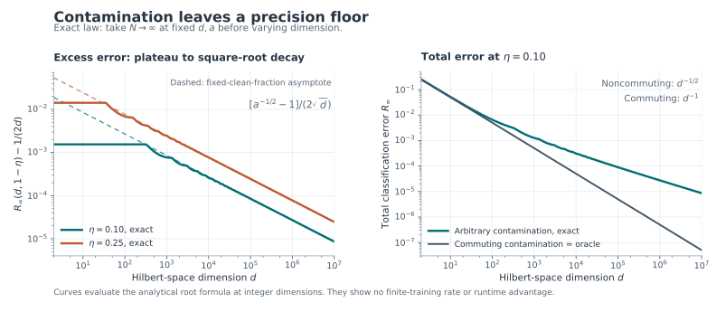

# What contamination prevents, and what a prediction can avoid

The learner's job is to return one label for one clean test. It need not name the clean state, reconstruct its amplitudes or preserve a model for future predictions. Those distinctions determine both the information limit and the finite circuit.

## One training state can hide several clean sources

The training density matrix $`\rho`$ is observable in the limit of enough specimens. Its decomposition into a clean state and a contaminant generally is not. The same $`\rho`$ can satisfy $`\rho\succeq aP`$ for several nonorthogonal pure states. No collective training measurement can distinguish two instances whose entire training input is identical.

The [finite phase family](precision_floor.md#a-finite-least-favorable-family-of-indistinguishable-sources) realizes that ambiguity at the exact worst prediction error. A separate two-target construction shows that clean-state estimation has a worst-case trace-distance loss of at least

```math
\frac12\min\left\{1,\frac{1-a}{a}\right\},
```

even with exact knowledge of the training density matrix. At a fixed nonzero contamination fraction this reconstruction loss remains bounded away from zero as the dimension grows.

Recognition is different. A test from the maximally mixed background occupies each direction with probability $`1/d`$. Accepting extra directions can cover uncertainty about the clean target at a small false-positive cost. The exact law makes that tradeoff quantitative, rather than treating nonidentifiability as a blanket impossibility of useful prediction.

## Two precision scales

For a small contamination fraction $`\eta=1-a\le1/4`$, the unavoidable excess error is

```math
R_\infty(d,1-\eta)-\frac1{2d}
=\Theta\!\left(\min\left\{\eta^2,\frac{\eta}{\sqrt d}\right\}\right).
```

When $`\eta\sqrt d`$ is small, a slightly rotated leading direction accounts for the ambiguity and the excess has order $`\eta^2`$. With more available directions, spreading weak compatible components across them changes the relevant cost to order $`\eta/\sqrt d`$. The exact scalar root resolves the boundary and the fractional-coordinate changes; the order notation does not locate an exact crossover point.

The [finite-copy bounds](finite_copy.md) reflect these mechanisms. A constant-gap top-eigenvector filter is sufficient above the $`O(\eta^2)`$ scale. A lower spectral threshold handles finer accuracy when the dimension is sufficiently large. Resolving a smaller threshold requires longer simulated evolution and more retained program specimens. The information limit and the cost of approaching it are separate quantities.



The curves evaluate the exact scalar formula at integer dimensions. Dashed curves show the fixed-clean-fraction asymptote. The limit is taken with $`N\to\infty`$ first; these curves are not finite-copy performance measurements. [Figure source and full caption](../verification/figures/README.md).

## Absolute error and relative oracle accuracy

For fixed $`a\in(0,1)`$, first take the infinite-training limit at fixed dimension and then increase $`d`$. The exact result gives

```math
R_\infty(d,a)
=\frac{a^{-1/2}-1}{2\sqrt d}+O_a(d^{-1}),
\qquad
R_\star(d)=\frac1{2d}.
```

Both the error and the absolute excess tend to zero. The ratio to the oracle error instead grows as $`\Theta_a(\sqrt d)`$. Thus vanishing excess does not mean vanishing relative regret or oracle-level scaling. The claim is accurate prediction despite source ambiguity, with an exactly quantified residual cost.

For example, at ten percent arbitrary contamination, the exact asymptotic risks are:

| Dimension $`d`$ | Oracle and commuting-contamination risk | Arbitrary-contamination risk | Absolute excess |
|---|---|---|---|
| $`2`$ | $`0.25`$ | $`0.2515480`$ | $`0.0015480`$ |
| $`256`$ | $`0.001953125`$ | $`0.003501128`$ | $`0.001548003`$ |
| $`2^{20}`$ | $`4.768372\times10^{-7}`$ | $`2.678608\times10^{-5}`$ | $`2.630925\times10^{-5}`$ |

These are evaluations of the exact infinite-training formula, not finite-sample experiments or hardware measurements. [The verification code](../verification/check_floor.py) computes the scalar root and independently checks it against compatible-spectrum decision problems.

## The role of noncommuting contamination

The [commuting comparison](commuting_comparison.md) keeps the same quantum source and test interfaces but requires $`[\sigma,P]=0`$. Exact training information then restricts the clean target to eigenspaces of $`\rho`$ with eigenvalues at least $`a`$. Accepting their union is optimal. The worst risk is

```math
R_\infty^{\mathrm{comm}}(d,a)
=\frac{\min\{d,\lfloor1/a\rfloor\}}{2d}.
```

For $`a>1/2`$, the clean direction is unique and this risk equals the oracle error. General contamination permits clean vectors that are not eigenvectors of $`\rho`$, producing positive excess even below that contamination level. At every fixed $`a\in(0,1)`$, the commuting risk has order $`d^{-1}`$ and the unrestricted risk has order $`d^{-1/2}`$. The comparison isolates a cost of nonorthogonal mixture decompositions, rather than a difference in supplied classical descriptions or computational power.

## What the finite-copy comparison says

The coherent algorithm consumes training specimens to implement a spectral decision on the later test. At fixed clean fraction and fixed nontrivial target error, its sufficient number of specimens does not increase with dimension in the stated regime. A learner that first reduces all training information to a classical record still needs $`\Omega(d)`$ specimens in the worst case, because the contaminated class includes the inherited clean pure-state family.

This sample comparison allows arbitrary collective quantum processing during the compilation stage and unlimited classical records and computation. It concerns the information retained across the train–test boundary. It does not assert that every classical algorithm on classically specified features needs exponentially many examples.

The [resource account](resources.md) retains the actual source-preparation cost, all offline training storage, controlled-swap gates, phase estimation, finite gate synthesis and the single consumed test. At errors approaching the $`\eta/\sqrt d`$ floor, the stated sufficient sample bound can grow polynomially with $`d`$. No optimal finite-copy precision law, experimental crossover or unconditional total-runtime advantage is inferred from the fixed-accuracy sample separation.

## Attribution and reach

Ensemble nonuniqueness, quantum binary discrimination, convex minimax, the sharp scalar Rényi/variation frontier, density-matrix exponentiation and clean quantum-reference advantages have established antecedents. The [related-work account](../references/related_work.md) identifies them. Their combination is used to solve a specific operational prediction limit, with explicit compatible adversaries and a finite-copy implementation account.

The pure clean target, known maximally mixed background, IID state-level training contamination and clean test are material assumptions. Independent local hardware noise is a different source of error. Correlated poisoned batches, arbitrary mixed clean states, unknown backgrounds, contaminated tests and repeated use of the learned information require additional proofs. In particular, a small background false-positive probability here comes from a diffuse known background; it should not be transferred to a different classification problem by changing its name.
