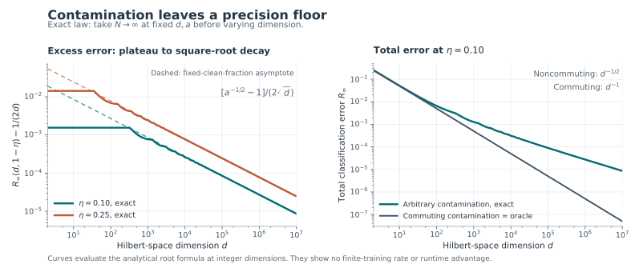

# Exact precision-floor figure



**Caption.** The left panel evaluates the exact contamination excess for $`\eta=0.10`$ and $`0.25`$. At low dimension it follows the first-interval plateau; at high dimension it approaches $`[a^{-1/2}-1]/(2\sqrt d)`$, shown dashed. The right panel compares total error at $`\eta=0.10`$ with the exact commuting-contamination floor, which equals the known-state oracle $`1/(2d)`$ in this majority-clean regime. Every plotted dimension is an integer between two and ten million.

These are evaluations of the proven root formula, not simulated experimental data. The limit is ordered: $`N\to\infty`$ first at each fixed $`d,a`$, then dimension is varied. The figure gives no finite-copy rate or runtime advantage. See [the precision proof](../../science/precision_floor.md) and [the commuting comparison](../../science/commuting_comparison.md).

Regenerate from the repository root with:

```bash
python -m pip install -r verification/figures/requirements.txt
python verification/figures/generate_precision_floor.py
```

The generator imports `root_floor` from [check_floor.py](../check_floor.py). The recorded generation used Matplotlib 3.10.8 with the numerical versions in the main verification requirements. SVG metadata and element hashes are fixed for reproducibility under the same plotting-library version. The resulting SVG preserves text for inspection and editing.
